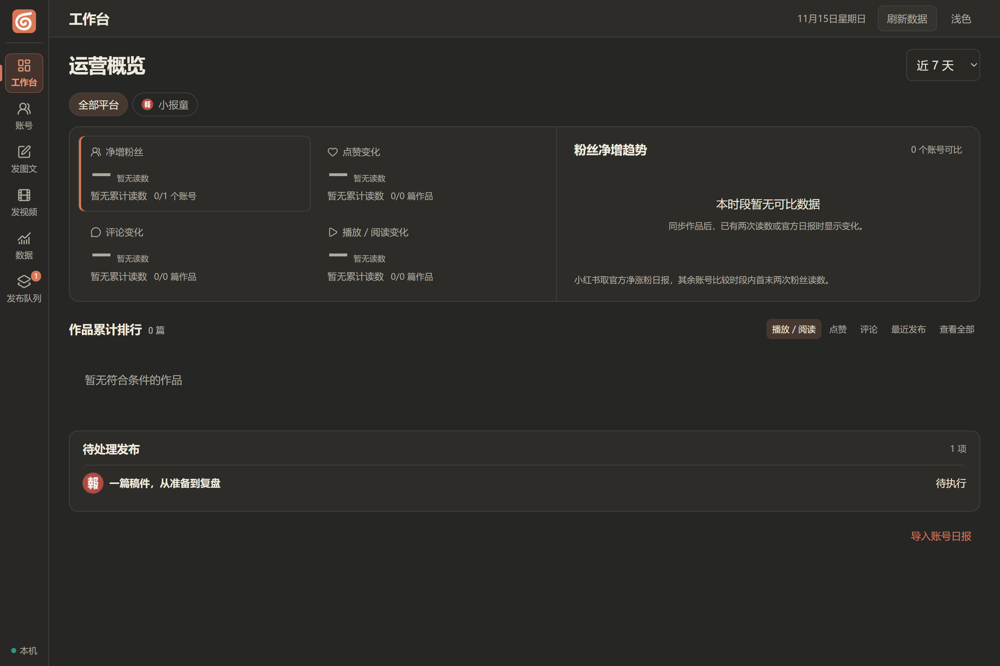
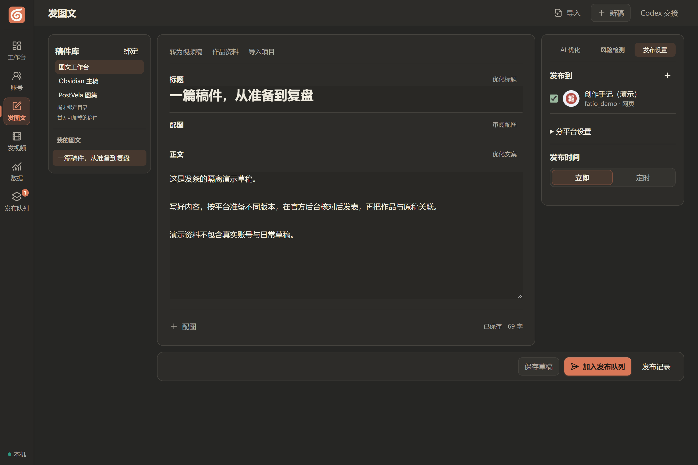
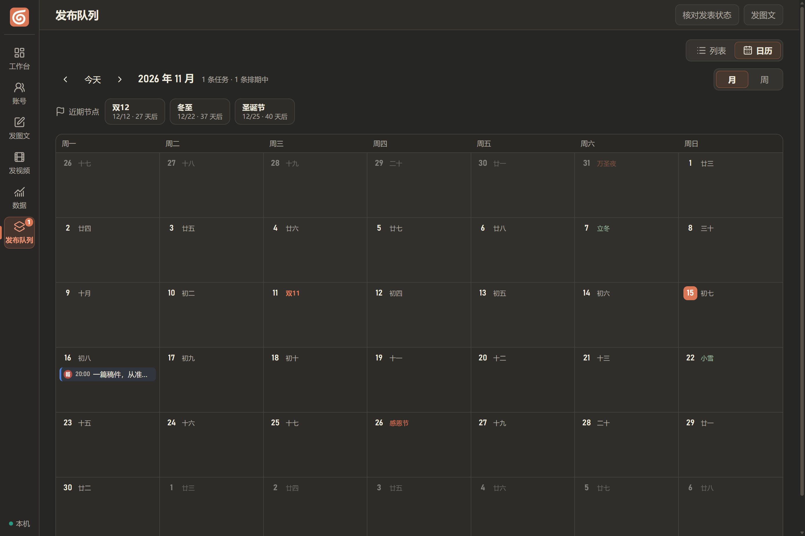

<p align="center">
  
</p>

# 发条 Fatio

**把创作、发布和复盘，放在一张工作台。——蒋啊讲出品**

面向个人创作者的 Windows 本地发布工作台。集中管理多平台账号、图文与视频草稿、发布队列和作品数据，让同一份内容按平台分别准备，并保留原稿与作品的关系。

> **1.12.2 开发者预览版** · Windows x64 · 2026-11-15。首次公开发布，当前主要在开发者本机验证。

[下载 Windows 安装包](https://github.com/zhizhiniao/Fatio/releases/download/v1.12.2-dev.1/Fatio-Setup-1.12.2-x64.exe) · [版本说明与校验文件](https://github.com/zhizhiniao/Fatio/releases/tag/v1.12.2-dev.1) · [使用说明](docs/USAGE.md) · [功能与验证范围](docs/STATUS.md) · [反馈问题](https://github.com/zhizhiniao/Fatio/issues)

## 为什么做发条

我同时维护图文和视频内容。写完一篇稿件之后，还要切换账号、整理不同平台的文案与封面、记住哪些内容发过，再回到各个平台找数据。

发条把这些重复步骤放在本地工作台里：内容先留在自己的稿件库，发布前分别准备，发布后关联作品与数据。它也能与 Obsidian、PostVela 和 NAS 数据目录配合使用。

## 可以做什么

| 工作 | 发条提供的能力 |
| --- | --- |
| 管理账号 | 按平台与账号切换官方后台，保留独立登录分区 |
| 写图文 | 草稿、版本保存、配图、平台专用文案与内容规则预检 |
| 发视频 | 批量准备视频、标题、简介、话题和分平台封面 |
| 做封面 | 提取视频帧、导入底图，按平台准备不同尺寸；可选调用本机 Codex 生成候选 |
| 安排发布 | 列表、月历与周历查看队列，调整排期，逐账号打开投稿后台核对 |
| 看作品 | 同步已授权账号的作品，保留作品链接、指标快照和原稿关系 |
| 做复盘 | 比较同一作品的有效采样，将数据导出到自选本地或 NAS 目录 |
| 接入稿件 | 读取自选 Markdown / Obsidian 目录与 PostVela 导出图集 |

网页投稿流程会停在平台页面，供你核对素材、账号与文案，并完成最终发表。X 的 API 模式需要你单独配置权限和凭据；平台接口能力与账号权限分别决定可执行范围。

## 界面预览

以下图片使用隔离演示资料，不含作者的日常账号和草稿。



| 图文草稿与分平台准备 | 发布日历 |
| --- | --- |
|  |  |

## 平台支持

| 平台 | 当前主要能力 | 使用边界 |
| --- | --- | --- |
| 抖音 | 官方登录、视频与图文准备、本人作品与数据同步 | 网页上传和数据读取依赖官方页面及登录状态 |
| 小红书 | 官方登录、图文与视频准备、作品与指标同步 | 网页不支持 Live Photo / GIF 动态图集 |
| 快手 | 官方登录、图文与视频准备、作品同步 | 字段与上传入口按官方页面实际能力处理 |
| 哔哩哔哩 | 官方登录、视频准备、作品同步与专栏链接导入 | 专栏配图提供逐张复制；最终发表需核对 |
| TikTok | 官方登录、视频准备、本人作品同步 | 可见范围和可用功能以账号与平台返回为准 |
| 微信公众号 | 官方登录、图文准备、发表记录与指标读取 | 长文 GIF 可走 PostVela；接口权限不足时无法代替账号取得权限 |
| 微信视频号 | 独立 WebView2 登录窗口、视频准备与作品数据读取 | 需要 Windows WebView2 和有效登录 |
| X 等其他渠道 | 按平台提供网页入口、文案准备或已配置的 API 能力 | 不能把入口支持理解为全流程自动发布 |

支持范围持续变化。完整验证边界见 [STATUS.md](docs/STATUS.md)，不承诺所有账号、地区、平台页面和素材格式均兼容。

## 安装与开始使用

1. 在 [Releases](https://github.com/zhizhiniao/Fatio/releases/tag/v1.12.2-dev.1) 下载 `Fatio-Setup-1.12.2-x64.exe`。
2. 退出正在运行的发条，运行安装包。默认安装到 `%LOCALAPPDATA%\Programs\发条 Fatio`。
3. 从桌面“发条 Fatio”打开程序，在“账号”中选择平台，通过官方窗口登录自己的账号。
4. 在“发图文”或“发视频”准备内容，选择账号，加入发布队列。
5. 打开相应平台后台，核对账号、图序、封面、正文与必填项，再完成发表。
6. 从“数据”查看作品与采样记录；需要时自行选择导出目录。

系统目标为 Windows x64。本机使用 Windows 11；其他电脑和干净环境仍需验证。安装器会检测视频号所需的 WebView2，缺少时调用微软安装程序联网安装。基础使用无需另行安装 Electron 或 Node.js。

安装包尚未做代码签名。Windows 可能显示未知发布者提示；请核对下载来源和 SHA-256，不确定时停止安装。

下载页提供 `SHA256SUMS.txt`。在 PowerShell 中运行下面的命令，并与校验文件比较：

```powershell
Get-FileHash '.\Fatio-Setup-1.12.2-x64.exe' -Algorithm SHA256
```

## 升级与数据保留

- 自 1.12.2 起，默认程序目录和快捷方式统一使用“发条 Fatio”。历史安装目录名称不再作为默认安装位置。
- 账号、草稿、素材、队列和登录分区继续使用原有的 `%APPDATA%\JAStudio` 数据身份。这是兼容存储目录，保留它是为了读取现有资料。
- 某些旧安装曾将该目录联接到其他位置。请一并保存实际目标，不要只备份目录联接本身。
- 升级前退出程序，并备份数据目录。程序文件与数据目录分开；不要把旧程序目录和数据目录一起删除。
- 新安装路径确认可用后，再清理旧程序。安装器不会擅自清空旧目录里的未知文件。
- 降级前备份当前资料。新版本数据库不保证能直接由旧版读取。

本次开发机的目录迁移和资料保留结果见[版本说明](docs/releases/v1.12.2-dev.1.md)。Cookie 文件保留不等于平台保证登录长期有效。

## 数据与隐私

账号和草稿保存在本机。平台网页会按正常登录与投稿流程访问相应服务；使用可选 AI 功能时，输入内容可能交给你配置或登录的模型服务。

NAS 导出由你选择目录并启用，包含账号、作品、指标和发布状态，不导出登录态、密钥与稿件正文。请自行管理导出目录的共享权限。

公开仓库和安装包不包含作者的账号数据库、Cookie、API 密钥或日常草稿。反馈问题时，请遮盖昵称、账号标识、作品隐私信息与凭据。

## 本地开发

环境：Windows x64、Git、Node.js 24.x 或更新的兼容版本、npm。依赖版本由 `package-lock.json` 固定。

```powershell
git clone https://github.com/zhizhiniao/Fatio.git
cd Fatio
npm ci
$env:FATIO_TEST_DATA = Join-Path $PWD '.runtime\dev-profile'
npm start
```

`FATIO_TEST_DATA` 使用独立开发资料，避免开发操作混入日常工作台。不要把已有账号目录用于自动化测试。

| 命令 | 用途 |
| --- | --- |
| `npm start` | 启动源码版 |
| `npm test` | 核心逻辑回归 |
| `npm run test:ui` | 多模块桌面流程；需要可交互桌面 |
| `npm run test:release` | 使用隔离资料检查安装版并生成公开演示截图 |
| `npm run build:brand` | 生成正式 PNG 与 ICO |
| `npm run build:channels` | 编译视频号 WebView2 窗口 |
| `npm run build:windows` | 构建 Windows 独立安装包 |

首次运行视频号功能前，执行 `npm run build:channels`。构建使用 Windows 自带的 .NET Framework 4.x 编译器和固定版本 WebView2 SDK；Windows 安装包还需要 [Inno Setup 6](https://jrsoftware.org/isinfo.php)。首次构建需要联网下载微软运行库相关文件。

```text
src/          桌面应用、平台适配、稿件与数据管理
ui/           界面、样式与正式品牌资产
native/       视频号原生窗口源码
build/        品牌、原生组件与安装包构建脚本
test/         自动化回归与隔离演示
docs/         使用说明、验证边界、版本记录与截图
release/      本地构建产物，不提交 Git
.runtime/     本地临时资料，不提交 Git
```

## 反馈与协作

欢迎通过 [Issues](https://github.com/zhizhiniao/Fatio/issues) 提交建议或问题。请附程序版本、Windows 版本、平台、复现步骤、预期与实际结果，以及脱敏后的截图。

平台页面可能改变。遇到登录失效、验证码、权限不足或官方页面变化时，请先保留原稿，再通过官方页面核对状态，避免重复发表。

## 授权与第三方组件

本项目采用 [GNU AGPL-3.0-or-later](LICENSE)，允许依照许可证使用、修改和分发。分发修改版及通过网络向用户提供相应服务时，请履行许可证中的源码提供义务。软件按原样提供，不附带保证。

第三方组件、平台商标和品牌图形保留各自权利与许可，详见 [NOTICE](NOTICE)。参考一幕的是仓库说明结构；发条的许可证以本仓库为准。

发条 Fatio 是独立项目，与所列内容平台及微软等公司无隶属或背书关系，不绕过平台的登录、权限和最终审核。

## 联系作者

有使用问题、建议反馈，或想交流个人创作工作流，可以扫码添加我的微信，备注“发条”。


公众号：**知鸟PLAN** · 微信：**aizzn2030**
